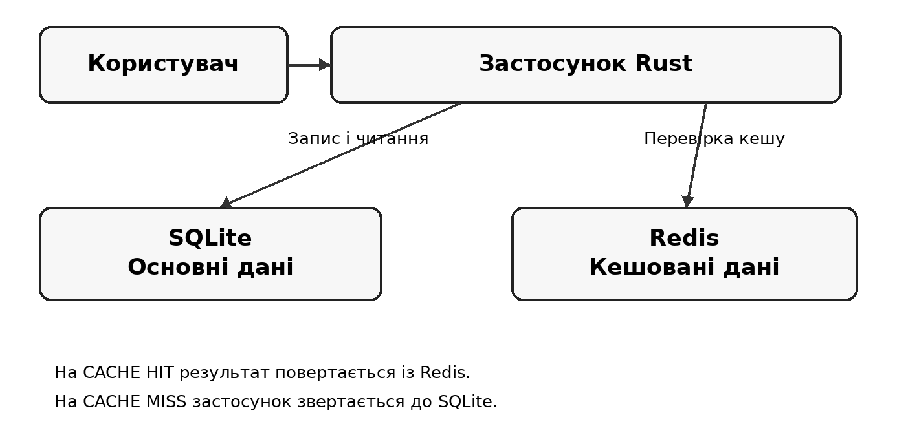

# Курсова робота: розробка та оптимізація програмного модуля обробки й кешування даних чайного інтернет-магазину на основі in-memory СУБД Redis

## ВСТУП

Інформаційна система інтернет-магазину працює не лише з переліком товарів. Вона має зберігати дані про зміни асортименту, обробляти продажі, знаходити потрібні позиції та надавати зведені показники діяльності. Для невеликого магазину частину цих операцій легко реалізувати через одну реляційну базу даних. Проте в міру накопичення історії продажів повторне формування однакових аналітичних звітів може створювати додаткове навантаження на сховище.

Важливою особливістю таких систем є відмінність між операціями, які необхідно виконувати щоразу, та результатами, що можуть тимчасово використовуватися повторно. Наприклад, отримання назви товару за його ідентифікатором не потребує складних обчислень. Натомість звіт, який підсумовує кількість проданих одиниць і виручку за багатьма записами, вимагає агрегування даних. Саме для другого випадку доцільно розглянути кешування готових результатів.

У цій роботі досліджується поєднання двох сховищ з різними завданнями. SQLite забезпечує постійне збереження каталогу та історії продажів, а Redis використовується як тимчасовий кеш товарних записів і сформованих звітів. Вибраний підхід відповідає принципу Cache-Aside: застосунок спочатку перевіряє кеш, а за відсутності даних звертається до основної бази та, за можливості, зберігає результат для наступних запитів \[9\].

Програмний модуль реалізовано мовою Rust. Її модель володіння та перевірки під час компіляції дає змогу керувати ресурсами без обов’язкового використання збирача сміття, що важливо для передбачуваної поведінки системних програм \[7\]. Для перетворення структур програми в JSON використано Serde, а керування збіркою і тестами здійснюється через Cargo \[18, 19\].

## 1 ПОСТАНОВКА ЗАДАЧІ І МЕТА РОБОТИ

### 1.1 Характеристика проблеми

Роботу чайного інтернет-магазину можна подати як послідовність запитів до даних. Покупець або оператор переглядає асортимент, знаходить товар, фіксує продаж, після чого адміністративна частина системи може отримати звіт. Незважаючи на відносно просту предметну область, ці операції мають різні вимоги до швидкості та актуальності інформації.

Основна база повинна надійно зберігати відомості, які не можна втрачати після завершення програми. До таких відомостей належать ідентифікатори товарів, назви, категорії, ціни, описи та записи про продажі. Водночас не кожен повторний запит до бази обов’язково повинен заново виконувати ті самі обчислення. Коли звіт уже сформовано і дані не змінювалися, повторне агрегування є зайвою роботою з погляду прикладної логіки.

Використання Redis як додаткового шару зберігання може скоротити кількість звернень до SQLite, але створює іншу проблему: кешований результат здатний застаріти. Якщо після формування звіту додати новий продаж, попередня сума виручки більше не відповідатиме вмісту бази. Отже, система повинна враховувати не лише швидкість читання, а й механізм оновлення або невикористання неактуальних записів \[9, 10\].

Ще одна група проблем пов’язана з помилками виконання. Redis може бути тимчасово недоступним, підключення може розірватися, а вміст кешу може не відповідати очікуваному формату. Такі обставини не повинні призводити до втрати інформації в SQLite. Для користувача особливо важливо, щоб недоступність допоміжного сховища не блокувала основні операції магазину.

Таким чином, предмет розробки охоплює три взаємопов’язані завдання: коректне зберігання даних, керування кешем і перевірку того, чи дає кешування відчутну перевагу для конкретних запитів.

### 1.2 Мета, об’єкт і предмет дослідження

Метою курсової роботи є розроблення програмного модуля на Rust, який забезпечує роботу з каталогом і продажами чайного інтернет-магазину, використовує SQLite як основне сховище та Redis для кешування повторюваних запитів, а також дає можливість оцінити ефективність вибраних способів оптимізації.

Об’єкт дослідження: процес отримання, обробки та зберігання даних у програмному забезпеченні невеликого інтернет-магазину.

Предмет дослідження: алгоритми кешування даних і аналітичних результатів, методи контролю актуальності кешу та організація взаємодії між застосунком Rust, SQLite і Redis.

Практичний результат роботи має бути представлений не загальною архітектурною пропозицією, а працездатним консольним застосунком із можливістю повторити перевірки коректності та продуктивності на тестових даних.

### 1.3 Завдання, які необхідно розв’язати

Для досягнення поставленої мети потрібно послідовно вирішити такі задачі:

- визначити склад даних про товари та продажі, потрібний для основних операцій інтернет-магазину;
- обрати способи постійного зберігання та швидкого повторного отримання інформації;
- реалізувати пошук товарів, реєстрацію продажів і формування зведеного звіту;
- передбачити алгоритм Cache-Aside для товарів і аналітичних результатів;
- визначити термін зберігання записів у кеші та спосіб контролю актуальності звітів;
- обробити типові збої з’єднання з Redis, помилки отримання та перетворення даних;
- підготувати засоби вимірювання часу простих і агрегованих запитів, а також накладних витрат на з’єднання;
- виконати модульні тести, перевірити можливість локальної компіляції та збірку на різних операційних системах.

Наведені завдання утворюють логічну послідовність: спочатку визначаються дані та критерії коректності, потім проєктується взаємодія сховищ, після чого створюється програма і проводиться експериментальна перевірка. Таке розмежування дозволяє оцінювати роботу не тільки за наявністю функцій, а й за їхніми вимірюваними властивостями.

### 1.4 Функціональні вимоги

Функціональні вимоги описують дії, які повинна виконувати програма з погляду користувача та внутрішньої логіки. Оскільки реалізація має навчальний характер, достатньо консольного меню, проте усі заявлені операції повинні приводити до зрозумілого результату та повідомляти про помилки введення.

| **Позначення** | **Вимога**                | **Очікуваний результат**                       |
|----------------|---------------------------|------------------------------------------------|
| ФВ-01          | Ініціалізація сховища     | Створення необхідних таблиць у SQLite          |
| ФВ-02          | Перегляд каталогу         | Відображення доступних товарів                 |
| ФВ-03          | Пошук за ID               | Отримання товару через кеш або SQLite          |
| ФВ-04          | Реєстрація продажу        | Збереження кількості та ціни на момент продажу |
| ФВ-05          | Формування звіту          | Підрахунок проданих одиниць і виручки          |
| ФВ-06          | Кешування звітів          | Повторне використання розрахованого результату |
| ФВ-07          | Оцінювання роботи кешу    | Відображення CACHE HIT і CACHE MISS            |
| ФВ-08          | Тестування продуктивності | Порівняння часу виконання різних способів      |

Таблиця 1.1. Основні функціональні вимоги до програмного модуля

Вимога збереження ціни на момент продажу є принциповою для обчислення виручки: зміна поточної ціни в каталозі не повинна змінювати суму раніше зареєстрованих продажів. Для цього значення ціни записується разом із кількістю проданого товару.

Робота із кешем повинна бути прозорою для користувача. Успішне читання з Redis і читання з SQLite мають призводити до однакового за змістом відображення товару чи звіту. Різниця полягає в джерелі отримання даних та витраченому часі, а не в логіці предметної області.

### 1.5 Нефункціональні вимоги та обмеження

До нефункціональних вимог віднесено коректність даних, стійкість до типових збоїв, можливість відтворення тестів і сумісність із різними операційними системами. На відміну від функціональних вимог, ці властивості характеризують не окремий пункт меню, а якість усього програмного модуля.

Коректність передбачає, що звіт обчислюється на основі збережених продажів, а після зміни основних даних повторний запит не повинен повертати завідомо застарілий звіт. Стійкість до збоїв означає, що недоступність Redis не скасовує можливості читати SQLite; водночас помилка самого основного сховища повинна бути повідомлена, а не прихована як успішний результат.

Для тимчасових записів задається TTL у 480 секунд. Це технічний компроміс між частотою повторних звернень до SQLite та терміном існування непотрібних ключів Redis. У разі зміни продажів строк дії сам по собі недостатній, тому для звітів передбачається окрема перевірка версії даних \[9, 14, 15\].

Вимога кросплатформеності пов’язана з використанням Rust і Cargo: проєкт має компілюватися з вихідного коду на Linux, Windows і macOS за наявності встановлених залежностей. Коректно розділяти успішне виконання модульних тестів і окрему перевірку інтеграції з Redis. Сам факт проходження тестів на трьох платформах ще не дорівнює перевірці кожної зовнішньої служби на кожній із них \[3, 18\].

У роботі не ставиться мета розробити повноцінний вебмагазин із реальними замовленнями, оплатою, обліковими записами чи складським залишком. Ці функції не потрібні для дослідження кешування та лише ускладнили б оцінку обраних алгоритмів. Програма зосереджена на мінімальному наборі операцій, достатньому для перевірки гіпотез щодо продуктивності.

### 1.6 Критерії оцінювання результату

Завершеність програмного модуля визначається сукупністю перевірюваних ознак. По-перше, застосунок повинен запускатися та коректно виконувати основні операції з SQLite. По-друге, кеш повинен відрізняти наявний запис від відсутнього, дотримуватися заданого TTL і коректно працювати з форматом JSON. По-третє, після операцій, які змінюють звітні дані, система має звертатися до актуальної версії результату.

Оцінка продуктивності базується на середньому часі одного запиту в мікросекундах для наперед визначеної кількості повторів. Порівняння виконується окремо для пошуку одного товару, формування агрегованого звіту та організації підключень до Redis. Оскільки ці сценарії мають різний обсяг роботи, один загальний висновок «Redis завжди швидший» був би методично некоректним.

## 2 ОПИС ПРЕДМЕТНОЇ ОБЛАСТІ, АНАЛІЗ І ПРОЄКТУВАННЯ СИСТЕМИ

### 2.1 Предметна область чайного інтернет-магазину

Для проєктування модуля обрано спрощену модель інтернет-магазину, у якій основними сутностями є товар і продаж. Товар описує одиницю асортименту, доступну для перегляду та пошуку. Продаж відображає факт реалізації певної кількості товару за зафіксованою ціною. Аналітичний звіт не потребує окремого постійного зберігання як первинна сутність, адже він обчислюється за наявними записами.

У навчальному наборі використано три товари: зелений чай Сенча, чорний чай Ассам і ромашковий чай. Така кількість достатня для демонстрації каталогу та пошуку за ID. Водночас для дослідження агрегованого запиту число записів про продажі навмисно збільшується: модель дозволяє порівнювати поведінку однієї і тієї самої операції за значно більшого обсягу вихідних даних.

Основними учасниками взаємодії виступають користувач консольної програми та програмний модуль. Користувач задає дію й вхідні параметри, а програма перевіряє їх, звертається до необхідного сховища та відображає результат. Redis і SQLite не є окремими користувачами системи; це її внутрішні компоненти зі спеціалізованими ролями.

### 2.2 Аналіз підходів до зберігання інформації

Можна розглядати три варіанти організації зберігання. Перший полягає у використанні лише SQLite, коли кожен запит безпосередньо обслуговує основна база. Другий передбачає збереження оперативних даних переважно в Redis. Третій поєднує SQLite для постійного зберігання та Redis для кешування результатів, які можна відновити з основної бази.

SQLite є вбудованою реляційною системою, яка працює в процесі застосунку без окремого серверного компонента. Вона підтримує SQL-запити, транзакції та файл бази даних, який зручно переносити і зберігати \[20\]. Це робить її доцільним вибором для навчальної системи з невеликим каталогом та історією продажів.

Redis використовує оперативну пам’ять для швидкого доступу до структур даних. Окрім рядків, він підтримує різні типи колекцій, але для цього проєкту достатньо зберігати JSON-представлення товарів і звітів як значення ключів \[11, 12\]. Відмінність між сховищами полягає не тільки в розміщенні даних, а й у додаткових витратах на обмін із сервером та серіалізацію.

Redis також підтримує механізми збереження стану на диск, зокрема RDB та AOF. Проте наявність цих можливостей не змінює ролі Redis у вибраній архітектурі: у цьому проєкті кеш не є єдиним джерелом важливих даних і може бути відновлений після втрати його вмісту \[13\].

| **Критерій**            | **Тільки SQLite**    | **Тільки Redis**              | **SQLite разом із Redis**          |
|-------------------------|----------------------|-------------------------------|------------------------------------|
| Постійні дані           | Основне сховище      | Залежить від конфігурації     | У SQLite                           |
| Повторні складні запити | Виконуються повторно | Можливе збереження результату | Кеш готового результату            |
| Додатковий сервер       | Не потрібен          | Потрібен                      | Потрібен для кешу                  |
| Недоступність Redis     | Не впливає           | Може блокувати роботу         | Доступний резервний шлях до SQLite |
| Складність підтримки    | Низька               | Середня                       | Вища через узгодження кешу         |

Таблиця 2.1. Порівняння варіантів організації сховища

Порівняння показує, що комбінована модель не є безумовно простішою або швидшою. Вона потребує додаткових перевірок наявності кешу, мережевої взаємодії та логіки актуалізації. Її переваги проявляються за повторних обчислювально складних запитів, а не автоматично для кожного звернення за первинним ключем.

### 2.3 Обґрунтування програмних технологій

Мову Rust обрано для розроблення основної логіки, обробки помилок і керування доступом до ресурсів. Система типів та модель володіння сприяють явному визначенню життєвого циклу даних, а використання Result і Option дозволяє розділяти успішні результати, відсутність запису та помилки виконання \[7\]. Для консольного застосунку це важливо під час роботи із зовнішніми службами, де помилки з’єднання або читання не можна вважати винятковими випадками.

Загальні підходи до низькорівневого програмування, організації пам’яті та взаємодії з операційною системою розглянуто у працях Г. Галісєєва та документації Intel. Вони слугують теоретичним тлом для розуміння витрат на обчислення й доступ до пам’яті, але в межах Tea Cache не розроблялися драйвери, ядро ОС або процесорні інструкції \[6, 26\].

Для розгляду особливостей Rust додатково використано праці Дж. Дженгсета, навчальні приклади Rust by Example та довідник Rust Nomicon. Вони охоплюють ідіоматичне програмування, правила володіння та питання безпеки пам’яті. У реалізованому модулі використано звичайні безпечні інтерфейси Rust; механізми unsafe не застосовувалися \[5, 17, 25\].

До рекомендованої літератури також належать матеріали Ф. Оппермана про створення операційної системи на Rust, посібник із вбудованих систем і книга з асинхронного Rust. Ці джерела допомагають визначити межі застосування мови в системному програмуванні; проте поточна курсова реалізація не є операційною системою, вбудованим застосунком або асинхронним сервером \[8, 24, 1\].

Як приклади організації невеликих системних програм у відкритих репозиторіях розглянуто rust-minigrep та ch57x-keyboard-tool. Вони наведені для порівняння предметної області та організації вихідних файлів, а не як залежності або запозичений код чайного магазину \[2, 4\].

Для доступу до SQLite використовується бібліотека rusqlite. Вона надає інтерфейс підключення, виконання запитів та підготовлених виразів. Зокрема, повторне використання підготовлених SQL-операторів може зменшувати додаткові витрати на їх обробку в межах одного з’єднання \[16\].

Для обміну з Redis використовуються бібліотека redis і стандартні команди GET, SETEX та інші необхідні операції. Команда SETEX задає значення ключа разом із часом життя; у сучасній документації Redis для нового коду рекомендовано також еквівалентний варіант SET з параметром EX. У навчальній реалізації застосовано встановлений час дії 480 секунд \[12, 14\].

Serde та serde_json забезпечують переведення об’єктів Rust до текстового формату JSON і відновлення їх із цього формату. Це дозволяє зберігати структури даних у Redis без потреби відтворювати окремі поля вручну. Водночас програма повинна перевіряти результат десеріалізації, адже пошкоджене або несумісне значення не повинно завершувати процес аварійно \[19\].

Cargo відповідає за завантаження залежностей, компіляцію та запуск тестів. Команди cargo build і cargo test мають однакове призначення на підтримуваних платформах, що спрощує перевірку проєкту після клонування репозиторію \[18\]. Для автоматизованих перевірок застосовано GitHub Actions, який дозволяє запускати збірку Rust у різних середовищах \[3\].

### 2.4 Структура вхідних, проміжних та вихідних даних

Вхідні дані надходять із двох джерел. Перше джерело - дії користувача в консольному меню: номер операції, ідентифікатор товару та кількість одиниць у разі реєстрації продажу. Друге джерело - уже збережені записи SQLite, які використовуються під час пошуку, підрахунків і формування звітів.

Для товару передбачено поля id, name, category, price і description. Ідентифікатор використовується як ключ пошуку, назва й категорія потрібні для відображення, ціна використовується для реєстрації продажу, а опис подає додаткову характеристику позиції. На рівні Rust відповідна інформація об’єднується в структуру Product.

| **Поле**    | **Тип за змістом** | **Призначення**          |
|-------------|--------------------|--------------------------|
| id          | Ціле додатне число | Унікальний ідентифікатор |
| name        | Текст              | Назва чаю                |
| category    | Текст              | Категорія товару         |
| price       | Число              | Поточна ціна одиниці     |
| description | Текст              | Опис характеристик       |

Таблиця 2.2. Структура даних товару

Запис про продаж пов’язаний із товаром і зберігає продану кількість та ціну одиниці на момент операції. При формуванні звіту ціна продажу використовується окремо від поточної ціни каталогу. Такий поділ дозволяє правильно підраховувати виручку навіть після зміни вартості товару.

| **Поле**   | **Тип за змістом** | **Призначення**            |
|------------|--------------------|----------------------------|
| id         | Ціле число         | Ідентифікатор запису       |
| product_id | Ціле число         | Посилання на товар         |
| quantity   | Ціле додатне число | Кількість проданих одиниць |
| unit_price | Число              | Ціна одиниці при продажу   |

Таблиця 2.3. Структура запису про продаж

Проміжними даними виступають ключі Redis, JSON-рядки, значення лічильників CACHE HIT і CACHE MISS, номер версії аналітичного звіту та виміряний час окремих операцій. Вихідні дані включають інформацію про товар, повідомлення про реєстрацію продажу, агреговані показники, статистику кешу та файли результатів експериментів.

Для кешу застосовуються зрозумілі просторово відокремлені назви ключів: наприклад, tea_cache:product:2 для конкретного товару. Ключ звіту містить також номер версії збережених даних. Така схема не змішує товари зі звітами та дозволяє розрізняти результати, отримані до і після змін у базі.

### 2.5 Логічна архітектура програмної системи

Архітектуру побудовано за принципом поділу обов’язків між модулями. Центральний застосунок Rust приймає команди користувача й вирішує, які операції необхідно виконати. Модуль роботи з SQLite читає і змінює постійні дані. Модуль Redis відповідає за кешовані значення. Окремі функції формують звіти, виконують вимірювання й перевіряють коректність результатів.

Нижче подано логічну схему взаємодії. Стрілка до SQLite відображає основний шлях отримання достовірних даних; Redis використовується як допоміжний шар для повторного читання.

Рисунок 2.1. Логічна схема взаємодії компонентів

Запропонований поділ має практичну перевагу: алгоритм взаємодії зі сховищами можна перевіряти та вдосконалювати незалежно від логіки консольного меню. Наприклад, змінити формат ключа або спосіб повторного використання з’єднання можна в модулі кешу без переписування підрахунку виручки.

### 2.6 Алгоритм Cache-Aside та контроль актуальності звітів

Застосунок спочатку визначає ключ запитуваних даних і намагається отримати його з Redis. Якщо значення присутнє й успішно перетворюється в очікувану структуру, результат використовується без SQL-запиту. Це сценарій CACHE HIT. Якщо ключ відсутній, запис застарів або дані неможливо коректно прочитати, виконується резервний шлях через SQLite. Це сценарій CACHE MISS \[9, 10\].

Після звернення до SQLite результат може бути серіалізований у JSON і збережений у Redis із заданим TTL. Таким чином, кеш наповнюється за фактичними зверненнями, а не шляхом копіювання всього каталогу. Під час тимчасової недоступності Redis логіка повинна повертати результати з основної бази, якщо вона залишається доступною.

Для аналітичного звіту застосування лише TTL може призвести до використання попереднього результату після реєстрації нового продажу. Тому передбачено таблицю cache_revisions, яка зберігає номер актуальної версії даних. SQL-тригери, пов’язані з операціями INSERT, UPDATE та DELETE над товарами й продажами, збільшують номер версії. SQLite підтримує такі тригери як дії, що виконуються автоматично у відповідь на відповідні події \[9, 22\].

Ключ звіту формується з урахуванням поточного номера версії. Після зміни записів застосунок звертається до нового ключа, і навіть якщо старий результат ще фізично присутній у Redis, він не використовується для поточного запиту. Коли TTL мине, непотрібний запис видаляється автоматично. Такий підхід не вимагає примусового пошуку всіх попередніх ключів у Redis.

Водночас версіонування саме по собі не усуває всі питання конкурентного доступу. Якщо між читанням версії та формуванням звіту інший процес змінить базу, потрібно окремо забезпечувати узгоджене читання в транзакції. У межах навчального модуля основну увагу приділено послідовним операціям і коректному оновленню версії після запису, а висококонкурентний сценарій розглядається як напрям подальшого розвитку.

### 2.7 Формування аналітичних показників

Для підсумкового звіту необхідно визначити дві основні величини: загальну кількість проданих одиниць певного товару та виручку від його продажів. Перша величина обчислюється сумуванням quantity, друга - сумуванням добутків quantity на unit_price. Оскільки виручка залежить від ціни на момент продажу, розрахунок не повинен підставляти поточну ціну каталогу.

SQL дозволяє виконати ці операції через агрегування та групування записів. SQLite підтримує агрегатні функції SUM і COUNT, які застосовуються до наборів рядків; потрібно враховувати поведінку порожніх наборів даних, коли SUM може повернути NULL \[21\].

Звіт будується для товарів із каталогу з урахуванням відповідних записів продажів. Товари, для яких ще не було продажів, також повинні оброблятися коректно, щоб відсутні записи не спричиняли помилку під час виведення. Для повторних запитів готовий список рядків звіту перетворюється в JSON і може зберігатися в Redis.

Саме агрегований звіт обрано основним прикладом для дослідження ефективності кешування, оскільки витрати на його обчислення зростають зі збільшенням історії продажів. На відміну від простого читання за ідентифікатором, тут кеш дозволяє повторно використовувати вже виконану роботу.

### 2.8 Сценарії використання та потоки інформації

Сценарій перегляду каталогу починається з вибору відповідної команди меню. Програма отримує інформацію з SQLite та відображає її у зручному для читання вигляді. Цей сценарій не змінює даних і слугує початковою перевіркою наявності товарів.

Сценарій пошуку за ідентифікатором передбачає перевірку коректності числа, звернення до Redis та, за необхідності, отримання запису з SQLite. Якщо товару немає в основній базі, користувач отримує повідомлення про відсутність результату. Помилка кешу та відсутність товару розглядаються як різні ситуації.

Під час реєстрації продажу вводяться ідентифікатор товару й кількість одиниць. Програма перевіряє наявність товару, зчитує актуальну ціну та створює запис у SQLite. У разі успішного додавання даних підвищується версія звіту, тому наступне звернення до аналітичного результату використовує новий ключ кешу.

Сценарій формування звіту починається з читання номера версії. За відповідним ключем перевіряється Redis. Якщо звіту немає, програма виконує агрегований SQL-запит і зберігає готовий результат. Якщо сервер Redis тимчасово недоступний, звіт усе одно може бути обчислений із SQLite без кешування.

| **Сценарій**      | **Вхідні дані**    | **Внутрішня обробка** | **Вихідні дані**       |
|-------------------|--------------------|-----------------------|------------------------|
| Перегляд каталогу | Команда меню       | Читання товарів       | Список товарів         |
| Пошук товару      | ID товару          | Redis або SQLite      | Картка товару          |
| Запис продажу     | ID і кількість     | Перевірка та INSERT   | Підтвердження операції |
| Аналітичний звіт  | Команда меню       | Кеш або SQL-агрегація | Кількість і виручка    |
| Оцінка швидкості  | Кількість повторів | Вимірювання часу      | CSV із результатами    |

Таблиця 2.4. Основні інформаційні потоки програмного модуля

### 2.9 Основні ризики та рішення під час проєктування

Перший ризик пов’язаний із несвоєчасним оновленням кешованих даних. Для звітів він зменшується завдяки версіонуванню, а для інших тимчасових записів - за допомогою обмеження часу життя. Другий ризик - недоступність Redis. Його наслідки обмежуються тим, що SQLite залишається основним джерелом інформації.

Третій ризик стосується витрат на мережеві з’єднання. У випадку простого запиту накладні витрати на обмін із Redis і перетворення JSON можуть виявитися більшими, ніж виконання SELECT у вбудованій SQLite. Тому проєктування передбачає повторне використання працездатного з’єднання там, де це можливо, та окреме порівняння сценаріїв у експериментальній частині.

Четвертий ризик - неправильне введення та некоректне представлення даних. Його потрібно враховувати через перевірку числових параметрів, розділення ситуацій «запис відсутній» і «помилка сховища», а також безпечну обробку результатів JSON-десеріалізації. Для системного програмування це є частиною вимоги передбачуваності роботи застосунку.

У підсумку запропонована архітектура відповідає цілям навчального проєкту: зберігає критичні відомості в одному основному сховищі, використовує кеш лише там, де є можливість повторного читання, і допускає вимірювану оцінку ефективності. Наступний розділ курсової роботи має пояснити конкретну реалізацію модулів Rust, SQL-тригерів, команд Redis і механізмів перевірки помилок.

## 3 РЕАЛІЗАЦІЯ СИСТЕМИ МОВОЮ ПРОГРАМУВАННЯ

### 3.1 Склад програмних модулів і розподіл відповідальності

Практична реалізація системи виконана мовою Rust у вигляді консольного застосунку. Вихідний код поділено на окремі файли за функціональним призначенням. Такий підхід дозволив розробляти підсистеми роботи з SQLite, кешування, реєстрації продажів та тестування продуктивності незалежно одна від одної. Центральний файл main.rs відповідає за запуск програми, відображення меню, перевірку команд користувача та виклики відповідних модулів.

У файлі database.rs зосереджені операції з основною реляційною базою: початкове створення таблиць, запис товарів, підрахунок кількості позицій і отримання конкретного товару за його ідентифікатором. Файл cache.rs відповідає за роботу з Redis, перетворення інформації на JSON, збереження з обмеженим часом життя та опрацювання помилок кешу. Операції, пов’язані з історією продажів та аналітичним звітом, винесено до sales.rs.

Для порівняння швидкодії реалізовано три окремі засоби вимірювання. У файлі benchmark.rs проводиться дослідження отримання окремого товару, report_benchmark.rs відтворює навантаження агрегованого звіту, а connection_benchmark.rs порівнює організацію підключень до Redis. Відокремлення бенчмарків від бізнес-логіки запобігає змішуванню вимірювального коду з основними операціями магазину і робить сценарії експериментів зрозумілішими.

| **Файл**                | **Призначення**        | **Основні операції**                          |
|-------------------------|------------------------|-----------------------------------------------|
| main.rs                 | Керування застосунком  | Меню, обробка введення, маршрутизація команд  |
| database.rs             | Постійне зберігання    | SQLite, ініціалізація, пошук товару           |
| cache.rs                | Тимчасове зберігання   | Redis, JSON, TTL, обробка відмов              |
| sales.rs                | Продажі та звіти       | Реєстрація, агрегування, версіонування        |
| benchmark.rs            | Дослідження пошуку     | SQLite і Redis, час одного запиту             |
| report_benchmark.rs     | Дослідження звіту      | Агрегування 20 000 продажів та кеш            |
| connection_benchmark.rs | Дослідження підключень | Два з’єднання та повторне використання одного |

Таблиця 3.1. Функціональне призначення основних файлів проєкту

### 3.2 Представлення товарів і перевірка вхідних даних

Кожен товар у програмі представлено структурою Product, яка містить ідентифікатор id, назву name, категорію category, ціну price та опис description. Для цінового поля використовується числовий тип із плаваючою комою. У навчальному проєкті цього достатньо для демонстрації, але в промислових фінансових системах для грошових обчислень доцільніше застосовувати цілі одиниці мінімального номіналу або десяткові типи, щоб уникати проблем двійкового представлення дробів.

При запуску в основній базі мають бути доступні три початкові позиції: зелений чай Сенча, чорний чай Ассам і ромашковий чай. Їхні значення використовуються під час перегляду каталогу, пошуку за ID і під час реєстрації тестових продажів. Початкове заповнення виконується без створення дубліката товару з тим самим ключем, що дає змогу повторно запускати програму без накопичення однакових записів.

Консольне введення обробляється як рядок, який згодом перетворюється до потрібного числового типу. Цей етап необхідний, оскільки користувач може ввести літери замість номера операції, від’ємне значення або ідентифікатор, якого немає в базі. Коректна поведінка полягає не у припиненні роботи застосунку, а у повідомленні про неприйнятний параметр та можливості повторити дію.

Доцільно розділяти помилки формату введення та помилки предметної області. Наприклад, введення тексту замість ID є помилкою перетворення числа. Водночас коректний номер 99, відсутній у каталозі, не свідчить про несправність програми, а означає, що результат пошуку порожній. Для першої ситуації користувач отримує повідомлення про неправильний формат; для другої повідомлення про відсутність товару.

### 3.3 Створення та використання SQLite

SQLite обрано основним сховищем через можливість працювати з реляційними даними без окремого процесу СУБД. Після запуску застосунок відкриває файл бази tea_shop.db і за необхідності створює потрібні таблиці. Постійне збереження товарів і продажів дає змогу не втрачати їх при завершенні програми та не залежати від тимчасового стану кешу Redis.

Таблиця products містить товарний каталог, а sales зберігає факти продажів. Поле product_id у продажу пов’язує запис із конкретним товаром; quantity описує кількість одиниць; unit_price фіксує ціну на час операції. Останнє поле необхідне для того, щоб зміна поточної вартості товару не впливала на історично зафіксовану виручку. У звіті використовується саме ціна продажу, а не значення, яке зараз відображається в каталозі. Джерела для зовнішніх ключів SQLite: \[23\].

Зв’язок товарів і продажів дозволяє виконувати аналітичні SQL-запити, у яких поєднуються дані каталогу з історією транзакцій. Для одного товару може існувати багато записів про продажі, тому тип відношення між відповідними таблицями становить «один до багатьох». Запити, що формують агрегований звіт, групують продажі за ідентифікатором товару та обчислюють суму кількості одиниць і виручки.

| **Таблиця**     | **Основні поля**                       | **Функція**                          |
|-----------------|----------------------------------------|--------------------------------------|
| products        | id, name, category, price, description | Каталог товарів і характеристики чаю |
| sales           | id, product_id, quantity, unit_price   | Факти продажів та історична ціна     |
| cache_revisions | cache_name, revision                   | Номер версії аналітичного результату |

Таблиця 3.2. Логічні таблиці постійного сховища

При проєктуванні доступу до бази важливо передбачати обробку ситуацій, коли файл не можна відкрити, структура таблиці не відповідає очікуваній або операція запису завершується помилкою. Для таких випадків функції доступу до SQLite повертають результат виконання, а викликаюча частина програми визначає, яке повідомлення показати користувачеві. При цьому небажано перетворювати помилки основної бази на повідомлення про успіх, оскільки SQLite є джерелом достовірних даних.

### 3.4 Робота з Redis і серіалізація JSON

У розробленому модулі Redis використовується для тимчасового зберігання товарних записів і попередньо сформованих звітів. Доступ до значення організовано за ключем, який містить тип об’єкта та його ідентифікатор. Для товарів використовується зрозумілий простір імен tea_cache:product, тоді як ключ аналітичного звіту додатково враховує версію поточних даних.

Об’єкти Rust перед записом до Redis перетворюються на JSON. Цей формат обрано через його просту структуру й наявність бібліотек serde та serde_json. Під час зчитування потрібно виконати зворотне перетворення до структури Product або до набору рядків звіту. Такий механізм дозволяє зберігати кілька пов’язаних характеристик одним значенням ключа, але вимагає перевірки правильності формату.

У разі пошкодженого JSON або невідповідної структури даних програма не повинна аварійно завершуватися. Правильна реакція полягає у фіксації помилки, відмові від використання некоректного значення та поверненні до основного джерела даних. Для допоміжного кешу особливо важливо, щоб його помилка не перетворювалася на втрату доступу до каталогу чи звіту.

Запис до Redis виконується з обмеженим терміном життя 480 секунд. Цей параметр дозволяє автоматично очищати кеш від тимчасових об’єктів, які перестали використовуватися. Термін життя не дорівнює гарантії актуальності даних: якщо в таблицях продажів щойно відбулася зміна, чекати закінчення восьми хвилин було б неправильно. Саме тому для звітів створено незалежний від TTL механізм зміни версії.

### 3.5 Алгоритм Cache-Aside та повторне використання підключення

Підхід Cache-Aside дозволяє заповнювати кеш у міру надходження запитів. Спочатку програма формує ключ, потім перевіряє Redis. У випадку CACHE HIT зчитане значення перетворюється на структуру даних і повертається користувачеві. У випадку CACHE MISS виконується читання або агрегування в SQLite, після чого результат може бути записаний до Redis.

Під час початкового варіанта виконання CACHE MISS окремі виклики для перевірки значення та його запису могли відкривати два підключення до Redis. У досліджуваному оптимізованому сценарії ті самі операції виконуються через одне працездатне з’єднання. Такий підхід зменшує накладні витрати на встановлення зв’язку із сервером, особливо коли запитів багато.

Разом з тим повторне використання з’єднання потребує уважного опрацювання відмов. З’єднання може стати недоступним після успішної попередньої команди. У такому разі програма повинна повідомити про проблему та не продовжувати вважати непрацездатний ресурс справним. Для послідовного консольного застосунку повторне використання одного підключення є зрозумілим рішенням; для великої кількості одночасних клієнтів доцільним подальшим кроком був би пул підключень.

### 3.6 Реєстрація продажів та оновлення звітних даних

Операція реєстрації продажу починається з введення ідентифікатора товару та кількості одиниць. Після перевірки параметрів програма повинна переконатися, що товар справді існує в основній базі. Ціна береться з актуального каталогу на момент реєстрації і записується до sales разом із кількістю. Успішне виконання операції змінює історію продажів і, відповідно, майбутній агрегований звіт.

Для збереження актуальності звіту застосовано таблицю cache_revisions. Вона містить числовий лічильник, який підвищується після відповідних змін у SQLite. Автоматичне збільшення реалізовано SQL-тригерами, які реагують на INSERT, UPDATE і DELETE в таблицях товарів та продажів. Це знижує залежність від дисципліни викликів у прикладному коді: зміна бази через SQL також призводить до зміни версії.

Коли користувач повторно відкриває звіт, система зчитує поточну версію та формує відповідний Redis-ключ. Навіть якщо попередній результат ще не видалено за TTL, він має інший ключ і не використовується. Це дозволяє уникати повторного звернення до застарілої версії після послідовної операції запису. Однак гарантія повної узгодженості при одночасних змінах і читанні потребує транзакційного механізму, який у межах навчального сценарію не досліджувався.

Результат звіту складається з кількох рядків, кожен з яких описує товар, загальну кількість проданих одиниць і виручку. Якщо продажів не було, система повинна коректно відображати нульові показники. Тестування цього випадку важливе, оскільки SQL-функції агрегування можуть повертати порожній результат або NULL, і без належної обробки програма отримала б некоректні значення.

### 3.7 Організація тестів і засобів вимірювання

Модульні тести використовуються для перевірки ізольованих властивостей програмної логіки. У розробленому застосунку вони охоплюють формування порожнього звіту, правильність арифметичних підрахунків, зміну версії після запису продажу, серіалізацію даних, оновлення й видалення продажів та зміну характеристик товару. Для незалежності від робочого файлу бази перевірки використовують тимчасове середовище даних.

Продуктивність досліджується окремо від функціональної правильності. Для цього кожна операція виконується багато разів із фіксацією сумарної тривалості, після чого визначається середній час одного звернення. Результати зберігаються у CSV-файлах, що полегшує порівняння різних серій і подальше включення числових даних до пояснювальної записки.

Слід розуміти обмеження такого експерименту. Локальне обладнання, стан ОС, кешування самого SQLite та накладні витрати системних викликів впливають на абсолютні значення часу. Тому результати в роботі інтерпретуються як порівняння конкретних сценаріїв у дослідженій конфігурації, а не як універсальний рейтинг двох систем зберігання.

## 4 ОПИС ПРОГРАМНОГО ЗАБЕЗПЕЧЕННЯ

### 4.1 Призначення і сфера застосування

Tea Cache є консольним навчальним застосунком, призначеним для демонстрації алгоритмів обробки та кешування даних предметної області інтернет-магазину. Програма не здійснює інтернет-платежі, не веде реальні облікові записи клієнтів і не надає публічний вебінтерфейс. Її призначення полягає в опрацюванні невеликого товарного каталогу, запису продажів та дослідженні механізмів зменшення витрат на повторні запити.

Передбачений користувач має володіти базовими навичками роботи з терміналом і вводити команди через числове меню. Знання внутрішнього устрою Rust для виконання основних операцій не потрібне. Натомість встановлення з вихідного коду вимагає наявності Rust, Cargo та доступу до командного рядка операційної системи.

Для навчальної та демонстраційної експлуатації програма може запускатися локально на одному комп’ютері, а Redis може працювати на тому самому вузлі. SQLite не потребує окремого сервера. Така конфігурація спрощує повторення вимірювань і перевірку відмови кешу, оскільки стан служби Redis можна змінювати незалежно від основного сховища.

### 4.2 Системні вимоги та програмні залежності

Застосунок написано на Rust із використанням пакета Cargo для збирання. Основною зовнішньою службою є Redis, який забезпечує кешування, але не зберігає єдину копію критичних даних магазину. SQLite використовується у вигляді локальної файлової бази, а доступ із Rust реалізується бібліотекою rusqlite.

Для обміну даними між застосунком і кешем використано JSON через serde та serde_json. Ці бібліотеки повинні бути оголошені в Cargo.toml і встановлюються Cargo під час збирання. Файл Cargo.lock фіксує конкретний набір версій залежностей і має зберігатися разом із вихідним кодом, щоб полегшувати відтворення збірки.

| **Компонент**     | **Роль**                                          | **Обов’язковість**                 |
|-------------------|---------------------------------------------------|------------------------------------|
| Rust і Cargo      | Компіляція, тестування і запуск із вихідного коду | Потрібні для збирання              |
| SQLite / rusqlite | Основна база даних і SQL-операції                 | Обов’язкова частина застосунку     |
| Redis             | Тимчасовий кеш товарів і звітів                   | Необов’язковий для базових читань  |
| Serde, serde_json | Серіалізація та десеріалізація                    | Залежності проєкту                 |
| Git               | Клонування репозиторію                            | Потрібен для встановлення з GitHub |

Таблиця 4.1. Програмні компоненти середовища виконання

У середовищі Ubuntu Redis можна запускати як системну службу та перевіряти командою redis-cli ping. Успішна відповідь PONG означає, що сервер приймає звернення на налаштованому інтерфейсі. Для Windows і macOS спосіб встановлення та запуску Redis може відрізнятися, але Rust-застосунок зберігає однакову модель підключення через адресу сервера.

Кросплатформеність вихідного коду перевірено автоматичним збиранням і запуском модульних тестів у GitHub Actions для Ubuntu, Windows і macOS. Ці результати підтверджують сумісність коду і залежностей на перевірених runner-образах. Вони не означають, що всі можливі способи локального запуску Redis окремо протестовано на кожній операційній системі.

### 4.3 Структура дистрибутива і порядок встановлення

Вихідний код розміщено в публічному GitHub-репозиторії <https://github.com/Rad2007/TEA_Cache> . Такий спосіб розповсюдження відповідає вимозі методичних рекомендацій, згідно з якою користувач повинен мати змогу отримати програму клонуванням репозиторію та скомпілювати її локально. У репозиторії зберігаються вихідні файли, маніфест залежностей, Cargo.lock, опис проєкту та збережені результати експериментів.

Процедура встановлення починається з переходу до каталогу, у якому користувач хоче розмістити програму. Після виконання git clone створюється окрема папка з вихідними файлами. Далі потрібно перейти до неї та запустити cargo build --release. Cargo автоматично завантажує необхідні бібліотеки й створює виконуваний файл для поточної платформи.

Якщо користувач планує використовувати кешування, потрібно попередньо встановити та запустити Redis. Відсутність кеш-сервера не повинна блокувати можливість базової роботи з SQLite, однак у такому режимі результати запитів не будуть прискорюватися за рахунок кешу. Після відновлення доступності Redis застосунок може знову використовувати його для повторного читання.

Для перевірки цілісності інсталяції після клонування рекомендовано виконати cargo test. Успішне завершення тестів підтверджує коректність тих функцій, що покриті перевірками. Потім запускається виконувана програма або команда cargo run --release. Така послідовність дає змогу окремо оцінити збірку, результати тестів і безпосередню роботу інтерфейсу.

| **Команда**                                        | **Призначення**                |
|----------------------------------------------------|--------------------------------|
| git clone https://github.com/Rad2007/TEA_Cache.git | Отримання вихідного коду       |
| cd TEA_Cache                                       | Перехід до каталогу проєкту    |
| cargo build --release                              | Створення оптимізованої збірки |
| cargo test                                         | Запуск модульних перевірок     |
| cargo run --release                                | Запуск застосунку              |
| redis-cli ping                                     | Перевірка доступності Redis    |

Таблиця 4.2. Основні команди встановлення та перевірки

### 4.4 Організація консольного інтерфейсу

Узаємодія з користувачем відбувається через текстове меню, у якому кожна функція має власний номер. Такий інтерфейс дозволяє перевірити логіку зберігання і кешування, не витрачаючи ресурси на графічну оболонку. Користувач читає назву потрібної дії, вводить її номер і, за потреби, додаткові параметри.

Основні операції згруповано за призначенням. До роботи з каталогом належать перегляд списку товарів і пошук за ідентифікатором. Блок продажів забезпечує реєстрацію нового факту продажу та формування звітної інформації. Додаткові пункти меню дозволяють оцінити статистику кешу й виконати серії вимірювань.

| **Пункт** | **Дія**            | **Зміст**                                    |
|-----------|--------------------|----------------------------------------------|
| 1         | Перегляд каталогу  | Виведення товарів із бази                    |
| 2         | Пошук товару       | Отримання товару за ID через Cache-Aside     |
| 3         | Статистика кешу    | Показники CACHE HIT та CACHE MISS            |
| 4         | Бенчмарк пошуку    | Порівняння SQLite і Redis                    |
| 5         | Бенчмарк звіту     | Порівняння обчислення та кешування агрегації |
| 6         | Реєстрація продажу | Запис кількості та ціни до SQLite            |
| 7         | Звіт про продажі   | Відображення агрегованих показників          |
| 8         | Бенчмарк з’єднань  | Оцінювання витрат на Redis-підключення       |
| 0         | Вихід              | Завершення роботи застосунку                 |

Таблиця 4.3. Операції консольного меню

Під час пошуку товару програма має показувати основні характеристики вибраної позиції, а також джерело отримання даних. Повідомлення CACHE HIT означає використання значення із Redis, тоді як CACHE MISS вказує на потребу отримати дані з основного сховища. Такі повідомлення мають навчальну цінність, бо користувач може наочно спостерігати алгоритм кешування.

Статистика повторних звернень допомагає розрізняти вплив логіки кешу та фактичну продуктивність. Наприклад, велика кількість CACHE HIT свідчить, що кеш справді використовується, але не доводить сама по собі, що кожен запит став швидшим. Для цього необхідно порівняти час виконання однакових сценаріїв.

### 4.5 Типові помилки та реакція програмного забезпечення

Використання двох різних сховищ збільшує кількість потенційних відмов. Частина помилок залежить від користувача: некоректний пункт меню, неправильний формат ідентифікатора чи неприйнятна кількість товару. Інші помилки виникають на рівні середовища: непрацездатний Redis, недоступність файлу SQLite або неправильний JSON у кеші.

Обробка помилок повинна ґрунтуватися на розумінні ролі кожного компонента. Для помилки Redis існує резервний шлях через SQLite, тому застосунок може продовжити виконання основної операції. Для помилки запису до SQLite такого резервного джерела немає, тому важливо повідомити користувачеві про невиконану операцію, а не створювати враження, що продаж успішно збережено.

| **Ситуація**                     | **Очікувана реакція**                                   |
|----------------------------------|---------------------------------------------------------|
| Введено текст замість ID         | Показати повідомлення і не виконувати некоректний запит |
| Товару з указаним ID немає       | Повідомити про відсутність запису                       |
| Redis не відповідає              | Використати SQLite за можливості                        |
| Пошкоджений JSON у Redis         | Відмовитися від кешованого значення                     |
| Помилка запису продажу до SQLite | Повідомити про невиконану операцію                      |
| Немає продажів для звіту         | Коректно показати нульові підсумки                      |

Таблиця 4.4. Відмови та рекомендована поведінка програми

З точки зору надійності важливим є принцип відсутності прихованих успіхів. Якщо програма не змогла зберегти продаж, вона не повинна виводити повідомлення про його успішну реєстрацію. Аналогічно, пошкоджений кеш не можна мовчки вважати достовірною відповіддю. Усі такі ситуації потребують відокремленого опрацювання та зрозумілої реакції.

Роботу в умовах недоступного Redis було додатково перевірено вручну. Після вимкнення служби програма могла звертатися до основного сховища, а після відновлення з’єднання знову користуватися кешуванням. Це відповідає визначеній на етапі проєктування ролі Redis як допоміжного компонента, а не як єдиного джерела даних.

### 4.6 Обмеження та умови масштабування

Програма розроблена як локальний консольний модуль, тому результати навантажувальних експериментів не можна безпосередньо переносити на багатокористувацький вебсервіс. Зокрема, під час тестів не відтворювалися сотні одночасних клієнтських запитів, розподілені мережеві затримки або конкуренція кількох процесів за один кешований звіт.

Для використання у складнішому середовищі було б доцільно розглянути пул Redis-з’єднань, транзакційну узгодженість читання версії та побудови звіту, централізоване журналювання й окремі інтеграційні тести. У поточному файлі cache.rs уже підтримується змінна середовища REDIS_URL; додатково можуть бути потрібні механізми автентифікації до Redis, керування секретами та обмеження доступу до баз даних.

## 5 КОНТРОЛЬНИЙ ПРИКЛАД

### 5.1 Мета і порядок проведення перевірок

Контрольний приклад призначений для підтвердження коректності основних функцій програми та перевірки висновків щодо ефективності кешування. Дослідження поділено на функціональне тестування, вимірювання часу виконання окремих операцій, перевірку резервного шляху при відмові Redis та кросплатформену збірку проєкту.

Для перевірки функціональності використовувався початковий каталог із трьох товарів. У межах вимірювань агрегованого звіту застосовувалася окрема тестова база з 20 000 записів про продажі. Таке розділення потрібно для того, щоб робочий навчальний каталог не заповнювався штучними даними, необхідними лише для дослідження продуктивності.

Для порівняння швидкодії фіксувався середній час одного запиту в мікросекундах. У бенчмарках використовувалися повторювані серії, але вимірювання проводилися локально і послідовно. Результати відображають властивості конкретної конфігурації, а не універсальні максимальні можливості досліджуваних технологій.

### 5.2 Функціональна перевірка каталогу та кешу

Початкова перевірка передбачала запуск програми, відображення списку товарів і пошук за ідентифікатором. Для товару, якого ще немає в Redis, перший запит повинен перейти до SQLite. Після збереження результату повторний запит за тим самим ключем може бути обслугований із кешу. Завдяки цьому користувач наочно бачить відмінність між CACHE MISS і CACHE HIT.

Пошук за неіснуючим ідентифікатором має завершуватися повідомленням про відсутність товару. Окремо перевіряється, що некоректне введення не викликає аварійного завершення виконання. Така поведінка свідчить про відокремлення помилки користувацького введення від відмови сховища.

Після зупинення Redis перевіряється можливість продовжити роботу із SQLite. Втрата доступу до тимчасового кешу не повинна призводити до втрати каталогу або неможливості отримати агрегований результат. Після повторного запуску Redis кеш може наповнюватися заново. У межах розробки ці сценарії було перевірено вручну.

### 5.3 Порівняння отримання одного товару

У першому експерименті виконувалося повторне отримання одного товару за ID. Порівнювалися звернення до локальної SQLite та отримання JSON-представлення товару з Redis. Кількість повторів становила 100, 1 000 і 10 000, що дозволяє оцінити стабільність результату за різної тривалості серії.

| **Кількість запитів** | **SQLite, мкс/запит** | **Redis, мкс/запит** | **Швидше SQLite** |
|-----------------------|-----------------------|----------------------|-------------------|
| 100                   | 17,98                 | 188,11               | 10,46 раза        |
| 1 000                 | 18,18                 | 183,76               | 10,11 раза        |
| 10 000                | 16,71                 | 185,19               | 11,09 раза        |

Таблиця 5.1. Середній час отримання товару

У всіх трьох серіях SQLite забезпечила меншу затримку. Причина пов’язана з тим, що реляційна база в цьому проєкті вбудована в процес і містить дуже малий каталог; пошук за первинним ключем не вимагає помітної обробки багатьох рядків. Redis працює як окремий сервер, тому навіть локальний запит включає витрати на обмін повідомленнями та десеріалізацію JSON.

Отримані дані демонструють, що кешування не слід застосовувати автоматично до кожного запиту. Якщо вартість SQL-операції невелика, додатковий шар може збільшити затримку. Наявність CACHE HIT у цьому випадку не гарантує кращої швидкості порівняно з прямим отриманням даних із SQLite.

### 5.4 Дослідження кешування аналітичного звіту

Другий експеримент був спрямований на значно складніший сценарій. У тестовій базі створено 20 000 записів про продажі, після чого порівнювали повторне виконання агрегованого SQL-запиту та зчитування готового звіту з Redis. У першому випадку SQLite підсумовувала кількість і виручку, а у другому Redis повертав попередньо сформовані результати.

| **Кількість запитів** | **SQLite, мкс/запит** | **Redis, мкс/запит** | **Прискорення** |
|-----------------------|-----------------------|----------------------|-----------------|
| 100                   | 6048,90               | 188,85               | 32,03 раза      |
| 500                   | 6171,62               | 185,60               | 33,25 раза      |
| 1 000                 | 6112,94               | 179,11               | 34,13 раза      |

Таблиця 5.2. Порівняння часу формування та кешування звіту

Для всіх серій повторне читання кешованого звіту виявилося істотно швидшим. У найкоротшій серії прискорення становило 32,03 раза, у наступних 33,25 та 34,13 раза. Середній час отримання результату з Redis залишався близьким до двохсот мікросекунд, тоді як агрегований запит SQLite потребував приблизно шести тисяч мікросекунд.

Важливо правильно інтерпретувати цю різницю. Тут порівнюється не однакова елементарна операція двох баз даних. SQLite виконує групування і підсумовування великого набору записів, тоді як Redis обслуговує зчитування вже обчисленого представлення. Отже, експеримент підтверджує ефективність конкретного способу оптимізації програмного модуля: повторного використання готового результату складного запиту.

Ця перевага має практичну цінність для адміністративних панелей, де однаковий звіт може багаторазово запитуватися між змінами основних даних. У такому випадку кеш здатен скорочувати обчислювальне навантаження на основне сховище. Водночас правильна робота потребує оновлення версії кешу після кожної значущої зміни продажів або характеристик товарів.

### 5.5 Вплив повторного використання з’єднання Redis

Третє дослідження порівнювало два варіанти виконання операцій у ситуації CACHE MISS. Початковий варіант створював окремі з’єднання для звернення GET та подальшого запису SETEX. Оптимізований варіант повторно використовував одне з’єднання в межах послідовності операцій. Для коректного трактування результатів важливо зазначити, що цей бенчмарк ізолює витрати Redis, а не вимірює повний час обробки запиту інтернет-магазину.

| **Кількість запитів** | **Два з’єднання, мкс** | **Одне з’єднання, мкс** | **Скорочення** |
|-----------------------|------------------------|-------------------------|----------------|
| 100                   | 1402,41                | 766,40                  | 45,35 %        |
| 500                   | 1037,21                | 658,94                  | 36,47 %        |
| 1 000                 | 1004,92                | 639,65                  | 36,35 %        |

Таблиця 5.3. Витрати часу на різні способи Redis-підключення

Результати показали скорочення вимірюваного часу від 36,35 % до 45,35 %. Найбільшу відносну різницю спостерігали в серії зі ста повторів. Для довших серій оптимізований варіант також зберігав перевагу, що підтверджує доцільність зменшення кількості встановлюваних з’єднань для такого сценарію.

### 5.6 Модульне тестування та перевірка актуальності кешу

У поточній версії наданих вихідних файлів визначено дев’ять модульних тестів: шість у модулі sales.rs та три у модулі cache.rs. Перші шість перевіряють формування звітів, розрахунок кількості й виручки, серіалізацію JSON, а також зміну версії звіту після внесення, редагування та видалення продажів і змін товарів. Інші три охоплюють формування ключа товару, коректне читання JSON та обробку пошкодженого JSON без аварійного завершення програми.

| **№** | **Сценарій тестування**             | **Очікуваний результат**                           |
|-------|-------------------------------------|----------------------------------------------------|
| 1     | Звіт без продажів                   | Коректні нульові підсумки                          |
| 2     | Підрахунок кількості та виручки     | Правильні агреговані значення                      |
| 3     | Додавання нового продажу            | Підвищення версії кешу                             |
| 4     | Серіалізація та десеріалізація JSON | Збереження змісту структури                        |
| 5     | Зміна і видалення продажів          | Оновлення номера версії                            |
| 6     | Зміна характеристик товару          | Оновлення номера версії                            |
| 7     | Формування ключа товару             | Ключ Redis відповідає ідентифікатору               |
| 8     | Декодування коректного JSON товару  | Поля структури відновлюються без втрат             |
| 9     | Декодування пошкодженого JSON       | Функція повертає помилку, а не завершує застосунок |

Таблиця 5.4. Зміст автоматичних модульних тестів

Результати попередніх локальних запусків засвідчили успішне проходження первинних шести перевірок звітів; до наданого фінального коду також додано три модульні тести для кешу товарів. Для відтворення повного тестового набору потрібно виконати команду cargo test з усіма переданими файлами. Тести звітів використовують тимчасову SQLite-базу, тому не залежать від кількості фактичних продажів у tea_shop.db.

Особливу увагу приділено змінам, які роблять попередній звіт неактуальним. Тести перевіряють не лише додавання нового продажу, а й редагування та видалення записів, а також зміну товару. Таким чином, механізм версіонування тестується з кількох напрямів, а не тільки для одного успішного сценарію.

### 5.7 Кросплатформена перевірка на GitHub Actions

Для виконання вимоги методичних рекомендацій щодо Windows, macOS і Linux вихідний код було опубліковано в репозиторії GitHub і налаштовано автоматизоване тестування. Workflow зберігається в каталозі .github/workflows та запускається після внесення змін до репозиторію. Для кожної операційної системи виконується отримання коду, компіляція застосунку і запуск модульних тестів.

Під час підготовки workflow було виправлено структуру каталогу та конфігурацію подій запуску. Після цього GitHub Actions успішно створив три окремі завдання для Ubuntu Linux, Windows і macOS. У зафіксованому запуску всі три перевірки завершилися успішно, а попередні попередження про застарілі компоненти GitHub Actions були усунені.

| **Платформа** | **Перевірка**                  | **Результат** |
|---------------|--------------------------------|---------------|
| Ubuntu Linux  | Збірка Cargo та модульні тести | Успішно       |
| Windows       | Збірка Cargo та модульні тести | Успішно       |
| macOS         | Збірка Cargo та модульні тести | Успішно       |

Таблиця 5.5. Підсумок кросплатформеного тестування

Цей результат підтверджує, що вихідний код проєкту та використані залежності здатні збиратися у перевірених середовищах трьох операційних систем, а реалізовані модульні тести в них проходять. Для точності формулювань слід розрізняти цю перевірку й окреме інтеграційне тестування з реально запущеним Redis на кожній платформі. Останнє не є частиною описаної трьохплатформеної матриці.

Окрім автоматизованих перевірок, було проведено контрольне клонування репозиторію в інший локальний каталог. Після отримання файлів із GitHub проєкт компілювався засобами Cargo без перенесення попередньої робочої папки. Цим перевірено спосіб встановлення, який прямо передбачено методичними рекомендаціями.

### 5.8 Узагальнення результатів контрольного прикладу

Третій експеримент продемонстрував, що спосіб роботи із зовнішньою службою має значення незалежно від вибору кешу. Повторне використання одного Redis-з’єднання зменшило накладні витрати під час досліджуваної операції CACHE MISS. Одержані значення підтверджують необхідність оцінювати не лише алгоритмічну складність запиту, а й витрати на встановлення підключення, передачу даних і серіалізацію.

## ВИСНОВКИ

У процесі виконання курсової роботи було спроєктовано й реалізовано програмний модуль для обробки та кешування даних чайного інтернет-магазину. Основним сховищем обрано SQLite, а Redis використано як додатковий шар для повторного отримання товарів та аналітичних звітів. Застосунок розроблено мовою Rust з використанням модульної структури, бібліотек для роботи з SQL і JSON та засобів автоматичного тестування Cargo.

Під час дослідження встановлено, що ефективність кешування залежить від характеру операції. Для простого пошуку товару за ідентифікатором SQLite у локальній конфігурації забезпечила менший час відповіді. Натомість при повторному отриманні агрегованого звіту за 20 000 продажами використання попередньо обчислених даних Redis дало прискорення приблизно у 32–34 рази. Оптимізація повторного використання одного з’єднання з Redis дозволила скоротити вимірюваний час окремого сценарію CACHE MISS на 36–45 %.

Для підтримання актуальності звітів реалізовано версіонування ключів через SQLite-тригери, а для тимчасового зберігання встановлено TTL 480 секунд. Додатково передбачено резервне отримання даних із SQLite при недоступності Redis. У наданому фінальному вихідному коді передбачено дев’ять модульних тестів, із них три додатково перевіряють кеш товарів. Автоматизована збірка й тестування в GitHub Actions також успішно виконалися в Ubuntu, Windows і macOS, що підтвердило кросплатформеність перевіреної частини застосунку.

Отримані результати показують, що Redis доцільно використовувати насамперед для повторних складних запитів, коли вартість їх нового обчислення значно перевищує витрати на доступ до кешу. Розроблений модуль може бути основою для подальшого вдосконалення: перевірки паралельних клієнтських запитів, транзакційної узгодженості звітів, централізованого журналювання та використання пулу з’єднань.
